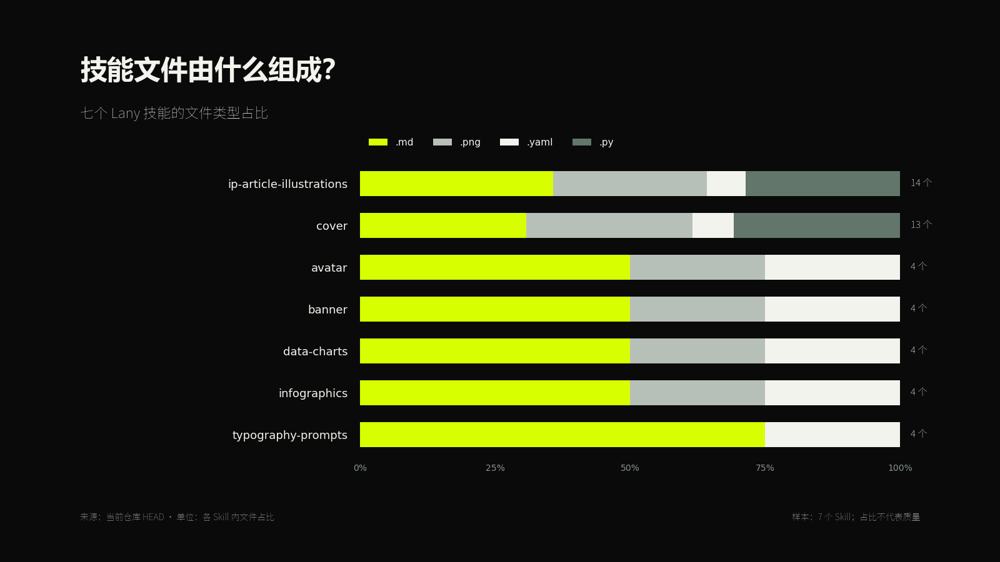
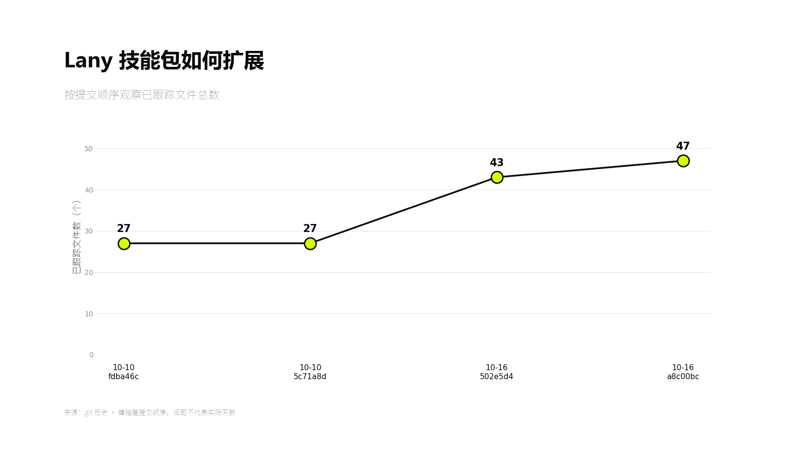
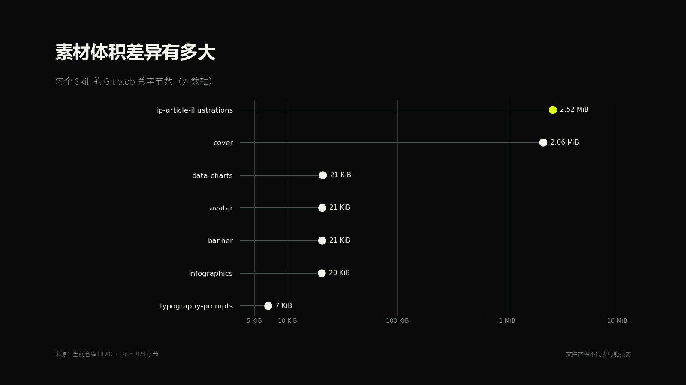
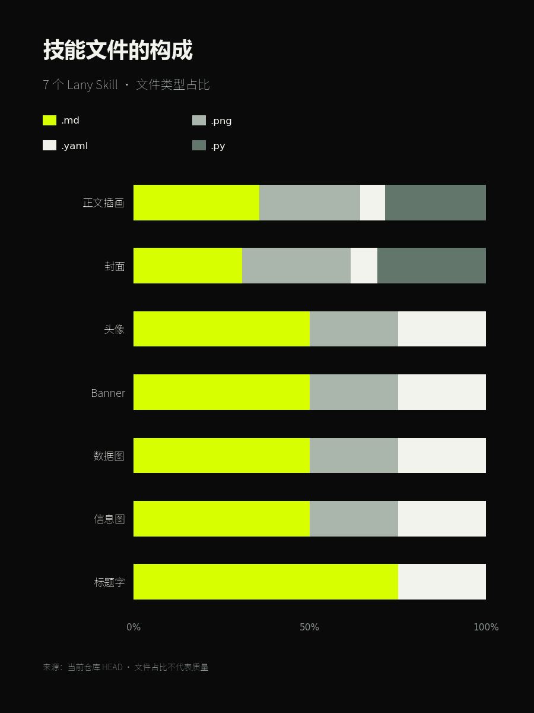

# Lany Data Charts

`$lany-data-charts` 用 Lany 小生的视觉体系制作文章数据配图、趋势图、比较图、动态数据画面和数据简报。它先确认数据、单位、口径和来源，再选择图型；没有真实数据时只能生成明确标为“示意”的样稿。

默认交付包括数据或数据引用、可复核计算、可编辑 SVG/HTML/代码和最终 PNG。黑 / 白 / `#D8FF00` 用于建立品牌识别，数据可读性优先于装饰。

## 安装与更新

这是供 Agent 读取的技能包。仓库提供工作流、参考规范和示例资源，没有独立网页或一键生成服务。

### Codex 安装

在终端执行（macOS / Linux）：

```sh
mkdir -p ~/.agents/skills
git clone https://github.com/LanyXiaosheng/lany-data-charts-skill.git ~/.agents/skills/lany-data-charts
```

安装后在对话里使用 `$lany-data-charts`。技能名没有仓库名末尾的 `-skill`。Codex 会自动检测技能；未显示时重启后再试。安装路径与发现规则参见 [OpenAI 官方技能文档](https://learn.chatgpt.com/docs/build-skills)。

如果此前已安装到 `~/.codex/skills/lany-data-charts` 且能正常调用，可沿用现有目录。只保留一份同名技能，不要重复安装；下方更新命令也要改成你的实际路径。目标目录已存在时，先检查其中的文件，勿直接覆盖自定义内容。

### 更新

先查看本地修改：

```sh
git -C ~/.agents/skills/lany-data-charts status --short
```

工作区无修改后执行；有修改时先提交或备份并处理：

```sh
git -C ~/.agents/skills/lany-data-charts pull --ff-only
```

其他 Agent 可按其技能目录规则安装整个文件夹，或让它读取 [SKILL.md](SKILL.md) 并遵循工作流。只复制 SKILL.md 会缺少参考文件和资源；调用语法与工具能力以宿主为准。

## 运行条件

- Agent 能读取输入文件、创建输出文件，并运行绘图代码或导出 SVG/HTML。
- 导出 PNG 需要宿主已有的 SVG 渲染器、浏览器截图或绘图库；此仓库没有绑定特定渲染器和依赖版本。
- 中文标签需要运行环境中可用的中文字体，导出后检查是否缺字。
- 默认用代码或 SVG/HTML 绘图，无需图片生成工具。仅在额外制作人物或氛围插画时需要宿主提供生图能力。
- 网页数据、远程材料和额外文件格式需要宿主具备相应读取能力；只给网址但无法访问时，请提供正文或数据文件。

## 准备哪些输入

| 输入 | 说明 |
| --- | --- |
| 数据 | CSV、Markdown 表格、可读取的 XLSX 或报告原文；说明工作表、字段或数据所在页 |
| 问题 | 图要回答的一句话，例如“哪个渠道带来的有效线索更多？” |
| 口径 | 单位、时间范围、分母、去重方式；金额注明币种 |
| 来源 | 文件出处或可访问链接、采集日期；区分原始值和计算值 |
| 发布场景 | 默认文章图 16:9，可指定 3:4 手机竖图、动态画面或简报 |
| 保存位置 | 项目根目录和便于辨识的主题名 |

无需先选图型。缺少数据时先补齐输入，或明确要求标为“示意”的版式草稿。

## 快速使用

```text
使用 $lany-data-charts 读取下面的数据文件并制作一张适合 X 长文的 16:9 数据图。

数据：<CSV / XLSX / Markdown 表格路径>
要回答的问题：<一句话>
单位：<单位>
时间范围：<起止时间>
来源：<来源与日期>

请先检查缺失值、分母和不可比较项，再选择合适图型。保存原始输入、计算结果、可编辑源文件和 PNG；在图内或图旁标明来源。
```

```text
使用 $lany-data-charts 分析这份报告里的真实数据，先提出 1—3 个可验证结论，再分别选择最合适的图型。不要预设一定使用柱状图，也不要为了视觉效果截断或改变数据关系。

报告：<文件路径或正文>
```

## 历史示例的数据范围

下方四张图沿用 [lany-skills 总仓库](https://github.com/LanyXiaosheng/lany-skills) 的历史演示资源，展示当时七个 `lany-*` 技能目录的统计结果，不代表当前实时数据。本独立仓库只包含一个技能，不能直接在这里统计“七个技能”。

需要重新计算时，先在数据工作目录下载总仓库（提交历史示例需要完整历史）：

```sh
git clone https://github.com/LanyXiaosheng/lany-skills.git lany-skills-source
git -C lany-skills-source rev-parse HEAD
```

将 `lany-skills-source` 的实际路径交给 Agent，并记录本次使用的完整提交 SHA。总仓库更新后，目录数量与数值可能变化，应以读取结果为准。历史图片未附生成时的完整数据快照，不能保证按当前 HEAD 重现相同数值。

## 示例 1：构成比例

适合多个对象拥有同一组分类，并且每个对象需要比较内部构成。

```text
使用 $lany-data-charts 读取 lany-skills-source 总仓库，统计其中 lany-* 技能目录的已跟踪文件类型占比。

数据来源：对 lany-skills-source 运行 git ls-tree -r HEAD；记录完整提交 SHA。
分类：.md、.png、.yaml、.py；没有实际出现的分类不显示。
图型：100% 横向堆叠条形图。
要求：每个 Skill 标出文件总数；单位为“文件占比”；注明“占比不代表质量”；输出 16:9 PNG、SVG 和汇总 CSV。
```



## 示例 2：提交历史

适合少量时间点或离散阶段的变化。

```text
使用 $lany-data-charts 读取 lany-skills-source 总仓库的完整 Git 历史，统计每次提交后 lany-* 目录中的已跟踪文件总数。

图型：带节点数值的折线图。
横轴：提交日期 + 短 SHA；相同日期保留为不同提交点。
纵轴：已跟踪文件数，单位“个”。
注明：横轴按提交顺序等距排列，间距不代表实际天数。
输出数据 CSV、16:9 PNG 和 SVG。
```



## 示例 3：跨数量级比较

当最大值和最小值相差数百倍时，线性轴会压扁小值；可以使用明确标注的对数轴。

```text
使用 $lany-data-charts 读取 lany-skills-source 总仓库，统计各 lany-* 技能目录的 Git blob 总字节数。

图型：横向点图；横轴使用对数刻度。
标注：KiB=1024 字节；1 MiB=1024 KiB；每个点直接显示 KiB 或 MiB。
来源：lany-skills-source 总仓库的 HEAD，记录完整提交 SHA；按目录实际数量出图。
必须在图上注明“文件体积不代表技能强弱”。输出 PNG、SVG 和源数据。
```



## 示例 4：手机竖版重排

同一份比例数据在横版缩图里会出现长标签和图例过小的问题。竖版要缩短名称并增加每行高度。

```text
使用 $lany-data-charts 把上一步重新计算的“Lany Skill 文件类型占比”重排为 3:4 手机竖版。

按实际出现的技能缩短名称，例如：正文插画、封面、头像、Banner、数据图、信息图、标题字。
图例只保留实际存在的 .md、.png、.yaml、.py。
横轴只显示 0%、50%、100%，每行保留足够高度；输出 400px 预览并检查分类名称与主比例是否可读。
```



## 已观察到的边界

- 七组 100% 堆叠条形图在完整 16:9 中可读，但缩到 400px 后图例与长技能名过小。
- 四个节点的趋势图在手机缩图中仍能表达主趋势；节点多、日期密集时需要减少标签或拆图。
- 对数轴能展示跨数量级数据，但必须明确标注，且不适合希望读者直接比较绝对差值的场景。
- 竖版与短中文标签能提高信息流可读性；精确比例仍需要点开或直接标值。
- 图表不能从不完整数据推断结论；分母、单位、缺失值、时间范围或来源不清时，应先补数据。
- 文件数量与体积示例用于测试图型，不代表 Skill 质量评分。

完整规则见 [SKILL.md](SKILL.md) 与 [data-rules.md](references/data-rules.md)。

## 输出与验收

默认保存到 `<项目根>/lany-assets/lany-data-charts/<slug>/`，其中 `<slug>` 是本次主题名。开始任务时写清项目根目录；文件名由本次任务确定。

| 交付物 | 内容 |
| --- | --- |
| 数据与计算 | 原始数据或可定位的引用、清洗说明、计算结果；可复算主要结论 |
| 可编辑源文件 | SVG、HTML 或绘图代码，按采用的绘制方式保留 |
| 发布图片 | 最终 PNG，默认 16:9；手机场景另做竖版或缩图预览 |
| 动态版本 | 仅在要求动态画面时交付可预览 HTML，其他视频格式取决于宿主导出能力 |
| 交付说明 | 结论、来源与日期、单位和口径、文件路径、未验证项 |

验收时抽查至少三个数据点，以及轴起点、排序、单位、百分比和增长率；再缩到手机宽度检查标题、标签和图例。只说“好看”不能替代数值校对。

如需插入文章，在请求中写明：“将图插入指定 Markdown 中首次论证该数据的段落之后，先备份原文，使用相对图片路径。”未明确要求时交付文件和建议位置。

## 常见问题

- **只有主题，没有数据？** 提供数据文件或可信来源。也可要求示意样稿，但图上须标明示意，不能据此写真实结论。
- **缺失值能直接当作 0 吗？** 不能。说明缺失原因与处理方式；不同分母或时间范围的数据要先统一口径。
- **能直接生成 Excel 图表吗？** 本技能默认交付可编辑 SVG/HTML/代码及 PNG。需要 Excel 文件时明确提出，宿主还需具备表格处理能力。
- **PNG 没生成？** 检查宿主是否有导出工具。仅生成了 SVG/HTML 时，应先交付这些源文件并说明缺少的导出环节。
- **图里中文乱码或手机看不清？** 检查中文字体、减少标签、缩短名称，或改为竖版；不要单纯缩放高密度横图。
- **安装后找不到技能？** 核对安装目录中直接存在 SKILL.md，使用 `$lany-data-charts` 而非仓库名；检查同名重复安装，未识别时重启 Codex。

## 仓库内容

- [SKILL.md](SKILL.md)：完整工作流与验收要求。
- [数据规则](references/data-rules.md)：数据口径、图表表达和交付模式。
- [头像参考](assets/lany-avatar-reference.png)：可选人物参考。
- [示例图片](docs/images/)：上方历史演示图，非实时数据看板。
- [Agent 元数据](agents/openai.yaml)：显示名称与默认提示词。
- [设计说明](DESIGN.md)：独立发布的结构与边界。

## 配合使用

解释流程或因果结构时使用 [Lany Infographics](https://github.com/LanyXiaosheng/lany-infographics-skill)；文章中需要人物场景时使用 [Lany IP Article Illustrations](https://github.com/LanyXiaosheng/lany-ip-article-illustrations-skill)。这些是可选搭配，不是本技能的必装依赖。

来源：[lany-skills/lany-data-charts](https://github.com/LanyXiaosheng/lany-skills/tree/master/lany-data-charts)。
